# 公式イメージを待たずに、PHP の RCE 修正版を自分たちで出せるか

[English](README.md) | 日本語

> 想定読者：CVE が出たら公式イメージの更新を待っている、Docker と GitHub Actions を使う人。所要時間：「0. 一枚で」だけなら 1 分、全体で 10 分。

2026-10-21、PHP に認証なしで RCE できる脆弱性が 2 件公開されました。[CVE-2026-109618](https://github.com/php/php-src/security/advisories/GHSA-w8hw-w9fx-j79w)（OOM 時の状態破損）と [CVE-2026-109619](https://github.com/php/php-src/security/advisories/GHSA-6wmf-4rv5-p3rp)（リクエスト間に残った状態）です（[PHP Foundation の記事](https://thephp.foundation/blog/2026/10/21/todays-php-security-release-and-how-were-strengthening-php-security/)）。

このリポジトリは、修正版が公開された当日に、署名と SBOM（イメージの部品表）の付いた修正版イメージを 7 バージョン分（7.4〜8.5）ghcr.io に出したデモです。

<details><summary>この資料の構成</summary>

この資料は、公式イメージやディストリビューションの更新を待たなくても、検証できる形の修正版を当日中に自分たちで出せた（その手順はこのリポジトリに残してある）ことを伝えます。

| 節 | 役割 | 見せるもの |
|---|---|---|
| 0. 一枚で | 何ができるようになるかを 1 枚で示す | アピールポイントの表 |
| 1. 待たずに出せる | 速さと、待たなくてよい理由 | CI の所要時間、パイプラインの図 |
| 2. EOL の 7.4 まで同じ手順 | サポートが終わったバージョンにも修正版を出せる | パッチの出どころと、render.sh の出力 |
| 3. 自前でも検証できる | 「自前ビルドは怪しい」への答え | SBOM の中身、署名の確かめ方 |
| 4. 中身が最小で、攻撃面が小さい | イメージの中身を最小にした | nonroot・シェルなし・マルチアーキテクチャ |
| 5. 運用が軽い | 変わったものだけを作り直す | 入力ハッシュとキャッシュ |
| 6. 保証しないこと | 何は保証しないか | EOL パッチとスキャナの限界 |

本文の `output` ブロックは [checks.json](checks.json) のコマンドで再生成して照合しています。CI の所要時間はリンク先の実行結果の値で、再実行はしていません。想定した読み手は [personas/demo-audience.md](personas/demo-audience.md) です（仮のペルソナ）。

</details>

## 0. 一枚で

| できること | 中身 | 根拠 |
|---|---|---|
| 待たずに出せる | php.net の修正版 tarball から、push 後 約 7 分で署名済みイメージを publish | 1 節 |
| EOL にも出せる | 7.4 / 8.0 / 8.1 は、PHP セキュリティチームの公式バックポートを当てて同じ手順で出す | 2 節 |
| 自前でも検証できる | ソースの sha256 照合、apk の署名、イメージ内の SBOM、cosign 署名、スキャン結果の添付 | 3 節 |
| 攻撃面が小さい | distroless（シェルなし）、uid 65532 で動く、amd64 と arm64 | 4 節 |
| 運用が軽い | 入力が同じなら PHP を再コンパイルしない。キャッシュが効いた PR は 1 分 16 秒 | 5 節 |

すべてのイメージは `ghcr.io/yowatari/php-oct2026-hotfix` にあり、認証なしで pull できます。

```sh
docker run --rm ghcr.io/yowatari/php-oct2026-hotfix:8.5 -v
docker run -d -p 9000:9000 ghcr.io/yowatari/php-oct2026-hotfix:8.5-fpm   # php-fpm（listen 9000）
```

## 1. 待たずに出せる

公式の修正版 tarball が php.net に出たら、バージョン番号を変えて push するだけで、署名済みのイメージが ghcr.io に出ます。**最初の実行では、push から 8.5.12 の署名済みイメージまで約 7 分でした。**

| 実行 | 内容 | 所要時間 |
|---|---|---|
| [run #1](https://github.com/yowatari/php-oct2026-hotfix/actions/runs/39644000263) | 初回。push → ビルド → publish → スモークテスト → cosign 署名（8.5.12、x86_64） | 約 6 分 40 秒（17:27:46 → 17:34:28 UTC） |
| [run #5](https://github.com/yowatari/php-oct2026-hotfix/actions/runs/39706478895) | 7 バージョン × amd64・arm64 をキャッシュなしでビルドしてテスト | 約 9 分 |
| [run #7](https://github.com/yowatari/php-oct2026-hotfix/actions/runs/39708192105) | 同じ入力でもう一度（キャッシュあり） | 1 分 16 秒 |
| [run #12](https://github.com/yowatari/php-oct2026-hotfix/actions/runs/39712391135) | main で 7 バージョン × amd64・arm64 を publish し、スモークテスト・署名・verify・スキャンまで（キャッシュあり） | 約 4 分 |

待たなくてよいのは、Wolfi のパッケージではなく、php.net の tarball から自分で PHP をビルドしているためです。作業を始めた時点（2026-10-21 16 時台 UTC）で、公開されている Wolfi の `php-8.5` は 8.5.11、`php-8.4` は 8.4.26 で、まだ修正前でした（観測時点の値です。今は更新されている可能性があります）。

使っている道具は 3 つです。Wolfi は Chainguard が公開しているコンテナ向けの Linux ディストリビューションで、イメージに入るライブラリはここから取ります。melange は Dockerfile の代わりに PHP を Wolfi の apk パッケージとしてビルドし、apko はその apk だけを並べてイメージを組み立てます。

ビルドからイメージまでの流れは次のとおりです（図の出どころは `.github/workflows/build.yml` のジョブの順）。



CI では、Chainguard が公開している Action（[melange-build](https://github.com/chainguard-dev/actions)、[apko-publish と vul-scans](https://github.com/chainguard-images/actions)）をそのまま使っています。

## 2. EOL の 7.4 まで同じ手順

PHP 8.1 以前はサポートが終わっていて、公式の修正版 tarball は出ません。代わりに PHP セキュリティチームが、7.4 / 8.0 / 8.1 向けに最小限のバックポートを php-src のブランチで公開しました（[php.net の告知](https://www.php.net/archive/2026.php#2026-10-21-5)）。

このリポジトリは、そのコミットを `patches/<ブランチ>/` に置き、最終版の tarball に当ててビルドします。パッチの中身は、公式の修正コミットそのものです。

<!-- output: patch-74 -->
```
Subject: [PATCH] Avoid state corruption via bailout
Fix GHSA-w8hw-w9fx-j79w (CVE-2026-109618)
Fix GHSA-6wmf-4rv5-p3rp (CVE-2026-109619)
```

`scripts/render.sh` は、php.net から tarball の sha256 を取り、パッチの有無を見て設定を作ります。パッチを当てたビルドは、melange の `epoch` を 1 にします。`epoch` はパッケージのリビジョン番号で、`7.4.33-r1` の `r1` がそれです。素の 7.4.33（`-r0`）と区別できます。

<!-- output: render-74 -->
```
version=7.4.33
epoch=1
sha256=924846abf93bc613815c55dd3f5809377813ac62a9ec4eb3778675b82a27b927
patches=1
legacy=1
```

`legacy=1` は、今の Wolfi の OpenSSL と libxml2 が 7.4 には新しすぎるため、OpenSSL 1.1.1w と libxml2 2.11.9 を同じパイプライン内でビルドして使う、という意味です。こうして、次のとおり 7 バージョンすべてのイメージを出しています。

<!-- output: run-all -->
```
8.5 -> PHP 8.5.12 uid=65532
8.4 -> PHP 8.4.27 uid=65532
8.3 -> PHP 8.3.36 uid=65532
8.2 -> PHP 8.2.35 uid=65532
8.1 -> PHP 8.1.34 uid=65532
8.0 -> PHP 8.0.30 uid=65532
7.4 -> PHP 7.4.33 uid=65532
```

## 3. 自前でも検証できる

自前ビルドで気になるのは「中に何が入っているか、誰が作ったか」を確かめられるかです。このパイプラインは、その確認を段ごとに組み込んでいます。

| 段 | 何を確かめるか |
|---|---|
| ソース | php.net が公開している sha256 と照合してから展開する |
| apk | melange が署名し、apko は署名を検証できた apk だけを入れる |
| イメージ | apko がパッケージごとの SBOM（SPDX 形式）をイメージ内の `/var/lib/db/sbom/` に入れる |
| 配布 | cosign で署名する。鍵は持たず、GitHub Actions が発行する ID（OIDC トークン）で一時的な証明書を取る「キーレス署名」 |
| スキャン | Chainguard の vul-scans Action が、脆弱性スキャナ Trivy と Grype の結果を、署名付きの添付情報（attestation）としてイメージに付ける |

**SBOM には、PHP のソースだけでなく、同梱した OpenSSL と libxml2 の取得元まで記録されています。** 7.4 のイメージで、php-hotfix の SBOM に書かれた取得元を表示すると次のとおりです。

<!-- output: sbom-74 -->
```
https://www.php.net/distributions/php-7.4.33.tar.xz
https://www.openssl.org/source/openssl-1.1.1w.tar.gz
https://download.gnome.org/sources/libxml2/2.11/libxml2-2.11.9.tar.xz
```

署名は、このリポジトリのワークフローが GitHub Actions 上で付けたものかを、次のコマンドで確かめられます。

```sh
cosign verify ghcr.io/yowatari/php-oct2026-hotfix:8.5 \
  --certificate-identity-regexp '^https://github.com/yowatari/php-oct2026-hotfix/.github/workflows/build.yml@' \
  --certificate-oidc-issuer https://token.actions.githubusercontent.com
```

<!-- output: cosign-verify -->
```
Verification for ghcr.io/yowatari/php-oct2026-hotfix:8.5 --
  - The cosign claims were validated
  - The code-signing certificate was verified using trusted certificate authority certificates
```

署名はマルチアーキテクチャの index と、その下の amd64・arm64 の各イメージに付いています。main の CI も publish のたびにこの verify を実行し、通らなければ失敗します。

## 4. 中身が最小で、攻撃面が小さい

イメージには PHP と、その実行に必要なライブラリだけが入っています。シェルはなく、プロセスは root ではない一般ユーザー（uid 65532、`nonroot`）で動きます。

<!-- output: no-shell -->
```
stat /bin/sh: no such file or directory
```

CLI 用（`:8.5`）と FPM 用（`:8.5-fpm`）は別のイメージで、CLI 用には php-fpm もヘッダも入っていません。どちらも amd64 と arm64 のマルチアーキテクチャです。

<!-- output: platforms -->
```
Platform:  linux/amd64
Platform:  linux/arm64
```

arm64 は、CI の `ubuntu-24.04-arm` ランナーで、エミュレーションを使わずにネイティブでビルドしています。

シェルがないので、Dockerfile でこのイメージを `FROM` にしたときは `RUN` が使えません。アプリは `COPY` で載せます。

<!-- source: examples/copy-app/Dockerfile -->
```dockerfile
FROM ghcr.io/yowatari/php-oct2026-hotfix:8.5
COPY app.php /app/app.php
CMD ["/app/app.php"]
```

<!-- output: copy-app -->
```
hello from 8.5.12
```

拡張モジュールを足すなら、`melange.tmpl.yaml` の configure を変えるか、別の melange パッケージにして apko の `packages` に加えます。こちらの手順はまだ試していません（未検証）。

## 5. 運用が軽い

CI が作り直すのは、入力が変わったものだけです。`scripts/render.sh` は、melange の設定とパッチから `melange_hash` を、それに apko の設定を加えて `image_hash` を出します。CI はこの 2 つを次のように使います。

| 状況 | 動き |
|---|---|
| `melange_hash` が同じ | キャッシュから apk を取り出し、PHP をコンパイルしない |
| `image_hash` の目印タグ `build-<hash>` が ghcr にある | 公開済みなので、そのバージョンは何もしない（main のみ） |
| PR | ビルドとテストだけ。ghcr には push しない |
| 毎日の schedule | apko だけを実行し、Wolfi のベースパッケージの修正を取り込む |

## 6. 保証しないこと

EOL の 7.4 / 8.0 / 8.1 に当てたパッチは、今回の 2 件だけに対処する最小限の緩和策です。ほかの未修正の脆弱性は残り、同梱した OpenSSL 1.1.1w もアップストリームのサポートが終わっています。8.2 以降へ移るまでのつなぎとして使ってください。

脆弱性スキャナが「修正済み」と判定するかは、スキャナ側のデータ次第です。このイメージの PHP は独自のパッケージ名（`php-hotfix`）なので、スキャナの結果は修正の証明になりません。修正済みかは、バージョン・パッチ・SBOM で確かめてください。

脆弱性を実際に攻撃して、修正されていることを確かめるテストはしていません。

このリポジトリはデモで、イメージは個人のアカウント（`yowatari`）の ghcr に置いています。本番の `FROM` に使うなら、リポジトリを自分たちの organization に fork して、自分たちの ghcr に出してください。ワークフローは `ghcr.io/<リポジトリ名>` に出すので、そのまま動きます。

## 次の CVE が来たら

| 状況 | やること |
|---|---|
| 修正版 tarball が php.net に出た | `.github/workflows/build.yml` の `DEFAULT_VERSIONS` を上げて main に入れる。sha256 は render.sh が取る |
| tarball はまだで、パッチだけが出た | `patches/<major.minor>/NNNN-*.patch` を置いて main に入れる。ビルドは `-r1` になる |
| 1 バージョンだけ急いで出したい | `workflow_dispatch` の `versions` に `["8.5.13"]` のような JSON を渡す |

## 理解度チェック

1. Trivy の結果が緑なら、このイメージは CVE-2026-109618 が修正済みだと言えるか。

<details><summary>答え</summary>

言えません。PHP は独自のパッケージ名（`php-hotfix`）で入っているので、スキャナは PHP の脆弱性データと結び付けられないことがあります。修正済みかは、`php -v` のバージョン、`patches/` の中身、SBOM の取得元で確かめます（2 節と 3 節）。

</details>

2. 7.4 のイメージに切り替えれば、7.4 を使い続けても安全か。

<details><summary>答え</summary>

安全ではありません。対処したのは今回の 2 件だけで、同梱の OpenSSL 1.1.1w もサポートが終わっています。移行までのつなぎです（6 節）。

</details>

3. apko の設定だけを変えて push したとき、PHP は再コンパイルされるか。

<details><summary>答え</summary>

されません。`melange_hash` は melange の設定とパッチだけから計算されるので変わらず、apk はキャッシュから取り出されます。`image_hash` は変わるので、イメージは作り直されます（5 節）。

</details>

4. `cosign verify` が通ったとき、何が分かるか。

<details><summary>答え</summary>

そのイメージが、このリポジトリの `.github/workflows/build.yml` によって GitHub Actions 上で署名されたことが分かります。中身が安全かどうかは分かりません。中身は SBOM で確かめます（3 節）。

</details>

## 付録

### タグ

| ブランチ | ソース | タグ（CLI / FPM） |
|---|---|---|
| 8.5 / 8.4 / 8.3 / 8.2 | php.net の修正済み tarball（8.5.12 / 8.4.27 / 8.3.36 / 8.2.35） | `8.5.12`, `8.5.12-r0`, `8.5` / `8.5.12-fpm`, `8.5-fpm` など |
| 8.1 / 8.0 / 7.4（EOL） | 最終 tarball（8.1.34 / 8.0.30 / 7.4.33）＋ 公式バックポート | `7.4.33-r1`, `7.4` / `7.4.33-r1-fpm`, `7.4-fpm` など |

拡張モジュールは最小構成です（mbstring, openssl, curl, zlib, mysqli / pdo_mysql, pdo_sqlite, bcmath, sockets, pcntl など。8.5 は OPcache を内蔵し、8.4 以前は opcache.so をビルドするが既定では無効）。必要なら `melange.tmpl.yaml` の configure を編集してください。

### ファイル

| パス | 内容 |
|---|---|
| `melange.tmpl.yaml` | PHP のビルド定義。`php-hotfix` / `-fpm` / `-dev` のサブパッケージとテスト |
| `legacy-deps.inc.yaml` | 7.4 / 8.0 / 8.1 用の OpenSSL 1.1.1w と libxml2 2.11.9 |
| `apko.tmpl.yaml` | イメージの定義（CLI と FPM） |
| `patches/<branch>/` | EOL ブランチ用の公式バックポート |
| `scripts/render.sh` | バージョンから melange と apko の設定とハッシュを作る |
| `scripts/smoke.sh` | イメージのスモークテスト |
| `examples/copy-app/` | このイメージにアプリを `COPY` で載せる例 |
| `.github/workflows/build.yml` | ビルド・publish・署名・スキャン |
| `checks.json`, `figures/` | この README の出力と図を検証するためのファイル |

### ローカルでのビルド

```sh
scripts/render.sh 8.5.12
docker run --rm -v "$PWD":/work -w /work cgr.dev/chainguard/melange keygen melange.rsa
docker run --privileged --rm -v "$PWD":/work -w /work cgr.dev/chainguard/melange \
  build build/8.5.12/melange.yaml --arch x86_64 --signing-key melange.rsa \
  --source-dir build/8.5.12/src --out-dir build/8.5.12/packages
docker run --rm -v "$PWD":/work -w /work cgr.dev/chainguard/apko \
  build build/8.5.12/apko.yaml php-hotfix:8.5.12 build/8.5.12/image.tar \
  -r /work/build/8.5.12/packages -k /work/melange.rsa.pub   # FPM は apko-fpm.yaml
docker load < build/8.5.12/image.tar
```
