# Can we ship a fixed PHP for an RCE without waiting for the official images?

English | [日本語](README.ja.md)

> Intended readers: people using Docker and GitHub Actions who wait for official image updates when a CVE drops. Reading time: 1 minute for "0. At a glance", 10 minutes for the whole thing.

On 2026-10-21, two unauthenticated RCE vulnerabilities in PHP were disclosed: [CVE-2026-109618](https://github.com/php/php-src/security/advisories/GHSA-w8hw-w9fx-j79w) (state corruption on OOM) and [CVE-2026-109619](https://github.com/php/php-src/security/advisories/GHSA-6wmf-4rv5-p3rp) (state left over between requests) ([PHP Foundation post](https://thephp.foundation/blog/2026/10/21/todays-php-security-release-and-how-were-strengthening-php-security/)).

This repository is a demo that, on the day the fixes were released, published fixed images with signatures and SBOMs (software bills of materials) for 7 versions (7.4 to 8.5) to ghcr.io.

<details><summary>How this document is organized</summary>

This document shows that, without waiting for official images or distribution updates, we were able to ship verifiable fixed images ourselves on the same day (and the procedure is kept in this repository).

| Section | Purpose | What it shows |
|---|---|---|
| 0. At a glance | One table of what becomes possible | Key points |
| 1. Ship without waiting | Speed, and why we don't have to wait | CI durations, pipeline diagram |
| 2. The same procedure down to EOL 7.4 | Fixed images even for unsupported versions | Where the patches come from, render.sh output |
| 3. Verifiable even when self-built | An answer to "self-built images are suspicious" | SBOM contents, how to verify signatures |
| 4. Minimal contents, small attack surface | The image contains as little as possible | nonroot, no shell, multi-arch |
| 5. Light to operate | Only rebuild what changed | Input hashes and caching |
| 6. What is not guaranteed | Limits | EOL patches and scanner limitations |

The `output` blocks in this document are regenerated and checked with the commands in [checks.json](checks.json). CI durations are the values from the linked runs and were not re-run. The intended reader is described in [personas/demo-audience.md](personas/demo-audience.md) (a hypothetical persona).

</details>

## 0. At a glance

| What you can do | Details | Evidence |
|---|---|---|
| Ship without waiting | From php.net's fixed tarball, signed images are published about 7 minutes after push | Section 1 |
| Ship for EOL versions too | 7.4 / 8.0 / 8.1 get the PHP security team's official backports, through the same procedure | Section 2 |
| Verifiable even when self-built | Source sha256 check, apk signatures, SBOM inside the image, cosign signatures, attached scan results | Section 3 |
| Small attack surface | distroless (no shell), runs as uid 65532, amd64 and arm64 | Section 4 |
| Light to operate | PHP is not recompiled when inputs are unchanged. A PR with a warm cache took 1 min 16 s | Section 5 |

All images live at `ghcr.io/yowatari/php-oct2026-hotfix` and can be pulled without authentication.

```sh
docker run --rm ghcr.io/yowatari/php-oct2026-hotfix:8.5 -v
docker run -d -p 9000:9000 ghcr.io/yowatari/php-oct2026-hotfix:8.5-fpm   # php-fpm (listen 9000)
```

## 1. Ship without waiting

Once the official fixed tarball is on php.net, you bump the version number and push, and signed images appear on ghcr.io. **On the first run, it took about 7 minutes from push to a signed 8.5.12 image.**

| Run | What it did | Duration |
|---|---|---|
| [run #1](https://github.com/yowatari/php-oct2026-hotfix/actions/runs/39644000263) | First run. push → build → publish → smoke test → cosign signing (8.5.12, x86_64) | About 6 min 40 s (17:27:46 → 17:34:28 UTC) |
| [run #5](https://github.com/yowatari/php-oct2026-hotfix/actions/runs/39706478895) | Build and test 7 versions × amd64/arm64 with no cache | About 9 min |
| [run #7](https://github.com/yowatari/php-oct2026-hotfix/actions/runs/39708192105) | Same inputs again (with cache) | 1 min 16 s |
| [run #12](https://github.com/yowatari/php-oct2026-hotfix/actions/runs/39712391135) | Publish 7 versions × amd64/arm64 on main, through smoke test, signing, verify and scan (with cache) | About 4 min |

We don't have to wait because we build PHP ourselves from the php.net tarball rather than using Wolfi's packages. When work started (around 16:00 UTC on 2026-10-21), the published Wolfi `php-8.5` was 8.5.11 and `php-8.4` was 8.4.26, both still unfixed (these are the values observed at that time; they may have been updated since).

Three tools are used. Wolfi is a Linux distribution for containers published by Chainguard; the libraries in the image come from it. melange builds PHP as a Wolfi apk package instead of using a Dockerfile, and apko assembles the image from just those apks.

The flow from build to image is as follows (the diagram follows the job order in `.github/workflows/build.yml`).



In CI, the Actions published by Chainguard ([melange-build](https://github.com/chainguard-dev/actions), [apko-publish and vul-scans](https://github.com/chainguard-images/actions)) are used as is.

## 2. The same procedure down to EOL 7.4

PHP 8.1 and earlier are out of support, so no official fixed tarballs are released. Instead, the PHP security team published minimal backports for 7.4 / 8.0 / 8.1 on php-src branches ([php.net announcement](https://www.php.net/archive/2026.php#2026-10-21-5)).

This repository puts those commits in `patches/<branch>/` and applies them to the final tarball when building. The patches are the official fix commits themselves.

<!-- output: patch-74 -->
```
Subject: [PATCH] Avoid state corruption via bailout
Fix GHSA-w8hw-w9fx-j79w (CVE-2026-109618)
Fix GHSA-6wmf-4rv5-p3rp (CVE-2026-109619)
```

`scripts/render.sh` fetches the tarball's sha256 from php.net, checks whether patches exist, and generates the configuration. Patched builds set melange's `epoch` to 1. `epoch` is the package revision number — the `r1` in `7.4.33-r1` — which distinguishes it from plain 7.4.33 (`-r0`).

<!-- output: render-74 -->
```
version=7.4.33
epoch=1
sha256=924846abf93bc613815c55dd3f5809377813ac62a9ec4eb3778675b82a27b927
patches=1
legacy=1
```

`legacy=1` means that because current Wolfi's OpenSSL and libxml2 are too new for 7.4, OpenSSL 1.1.1w and libxml2 2.11.9 are built in the same pipeline and used instead. This is how images for all 7 versions are shipped, as shown below.

<!-- output: run-all -->
```
8.5 -> PHP 8.5.12 uid=65532
8.4 -> PHP 8.4.27 uid=65532
8.3 -> PHP 8.3.36 uid=65532
8.2 -> PHP 8.2.35 uid=65532
8.1 -> PHP 8.1.34 uid=65532
8.0 -> PHP 8.0.30 uid=65532
7.4 -> PHP 7.4.33 uid=65532
```

## 3. Verifiable even when self-built

The concern with self-built images is whether you can check "what's inside and who built it". This pipeline builds those checks into each stage.

| Stage | What is checked |
|---|---|
| Source | Verified against the sha256 published by php.net before extraction |
| apk | melange signs them, and apko only installs apks whose signatures it can verify |
| Image | apko puts a per-package SBOM (SPDX format) in `/var/lib/db/sbom/` inside the image |
| Distribution | Signed with cosign. No keys are held: "keyless signing" obtains a short-lived certificate using the identity (OIDC token) issued by GitHub Actions |
| Scan | Chainguard's vul-scans Action attaches the results of the vulnerability scanners Trivy and Grype to the image as signed attestations |

**The SBOM records not only the PHP source but also where the bundled OpenSSL and libxml2 came from.** For the 7.4 image, the sources listed in the php-hotfix SBOM are:

<!-- output: sbom-74 -->
```
https://www.php.net/distributions/php-7.4.33.tar.xz
https://www.openssl.org/source/openssl-1.1.1w.tar.gz
https://download.gnome.org/sources/libxml2/2.11/libxml2-2.11.9.tar.xz
```

You can confirm that the signature was made on GitHub Actions by this repository's workflow with the following command.

```sh
cosign verify ghcr.io/yowatari/php-oct2026-hotfix:8.5 \
  --certificate-identity-regexp '^https://github.com/yowatari/php-oct2026-hotfix/.github/workflows/build.yml@' \
  --certificate-oidc-issuer https://token.actions.githubusercontent.com
```

<!-- output: cosign-verify -->
```
Verification for ghcr.io/yowatari/php-oct2026-hotfix:8.5 --
  - The cosign claims were validated
  - The code-signing certificate was verified using trusted certificate authority certificates
```

Signatures are attached to the multi-arch index and to each amd64 and arm64 image beneath it. CI on main also runs this verify on every publish and fails if it doesn't pass.

## 4. Minimal contents, small attack surface

The image contains only PHP and the libraries it needs to run. There is no shell, and the process runs as an unprivileged user (uid 65532, `nonroot`).

<!-- output: no-shell -->
```
stat /bin/sh: no such file or directory
```

The CLI image (`:8.5`) and the FPM image (`:8.5-fpm`) are separate, and the CLI image contains neither php-fpm nor headers. Both are multi-arch for amd64 and arm64.

<!-- output: platforms -->
```
Platform:  linux/amd64
Platform:  linux/arm64
```

arm64 is built natively on CI's `ubuntu-24.04-arm` runners, without emulation.

Because there is no shell, `RUN` can't be used when this image is the `FROM` of a Dockerfile. Add your app with `COPY`.

<!-- source: examples/copy-app/Dockerfile -->
```dockerfile
FROM ghcr.io/yowatari/php-oct2026-hotfix:8.5
COPY app.php /app/app.php
CMD ["/app/app.php"]
```

<!-- output: copy-app -->
```
hello from 8.5.12
```

To add extensions, change the configure options in `melange.tmpl.yaml`, or make a separate melange package and add it to apko's `packages`. This procedure has not been tried yet (unverified).

## 5. Light to operate

CI only rebuilds what has changed inputs. `scripts/render.sh` computes `melange_hash` from the melange configuration and patches, and `image_hash` from those plus the apko configuration. CI uses the two as follows.

| Situation | Behavior |
|---|---|
| `melange_hash` unchanged | Restore apks from cache; don't compile PHP |
| The marker tag `build-<hash>` for `image_hash` exists on ghcr | Already published, so nothing is done for that version (main only) |
| PR | Build and test only. Nothing is pushed to ghcr |
| Daily schedule | Run only apko, picking up fixes in Wolfi's base packages |

## 6. What is not guaranteed

The patches applied to EOL 7.4 / 8.0 / 8.1 are minimal mitigations addressing only these two issues. Other unfixed vulnerabilities remain, and the bundled OpenSSL 1.1.1w is also out of upstream support. Use them as a stopgap until you move to 8.2 or later.

Whether a vulnerability scanner reports "fixed" depends on the scanner's data. PHP in this image uses its own package name (`php-hotfix`), so scanner results are not proof of the fix. Confirm the fix through the version, the patches, and the SBOM.

No tests were run that actually exploit the vulnerabilities to confirm they are fixed.

This repository is a demo, and the images are hosted on a personal account's (`yowatari`) ghcr. If you want to use them as a production `FROM`, fork the repository into your own organization and publish to your own ghcr. The workflow publishes to `ghcr.io/<repository name>`, so it works as is.

## When the next CVE comes

| Situation | What to do |
|---|---|
| A fixed tarball is out on php.net | Bump `DEFAULT_VERSIONS` in `.github/workflows/build.yml` and merge to main. render.sh fetches the sha256 |
| No tarball yet, only a patch | Put `patches/<major.minor>/NNNN-*.patch` in place and merge to main. The build becomes `-r1` |
| Need to ship just one version urgently | Pass JSON such as `["8.5.13"]` to `versions` in `workflow_dispatch` |

## Comprehension check

1. If Trivy's results are green, can you say this image has CVE-2026-109618 fixed?

<details><summary>Answer</summary>

No. PHP is installed under its own package name (`php-hotfix`), so the scanner may not be able to match it to PHP vulnerability data. Confirm the fix with the version from `php -v`, the contents of `patches/`, and the sources in the SBOM (sections 2 and 3).

</details>

2. If you switch to the 7.4 image, is it safe to keep using 7.4?

<details><summary>Answer</summary>

No. Only these two issues were addressed, and the bundled OpenSSL 1.1.1w is also out of support. It's a stopgap until you migrate (section 6).

</details>

3. If you change only the apko configuration and push, is PHP recompiled?

<details><summary>Answer</summary>

No. `melange_hash` is computed only from the melange configuration and patches, so it doesn't change and the apks are restored from cache. `image_hash` does change, so the images are rebuilt (section 5).

</details>

4. What do you learn when `cosign verify` passes?

<details><summary>Answer</summary>

That the image was signed on GitHub Actions by this repository's `.github/workflows/build.yml`. It doesn't tell you whether the contents are safe; check the contents with the SBOM (section 3).

</details>

## Appendix

### Tags

| Branch | Source | Tags (CLI / FPM) |
|---|---|---|
| 8.5 / 8.4 / 8.3 / 8.2 | php.net fixed tarballs (8.5.12 / 8.4.27 / 8.3.36 / 8.2.35) | `8.5.12`, `8.5.12-r0`, `8.5` / `8.5.12-fpm`, `8.5-fpm`, etc. |
| 8.1 / 8.0 / 7.4 (EOL) | Final tarballs (8.1.34 / 8.0.30 / 7.4.33) + official backports | `7.4.33-r1`, `7.4` / `7.4.33-r1-fpm`, `7.4-fpm`, etc. |

Extensions are a minimal set (mbstring, openssl, curl, zlib, mysqli / pdo_mysql, pdo_sqlite, bcmath, sockets, pcntl, etc. 8.5 has OPcache built in; 8.4 and earlier build opcache.so but leave it disabled by default). Edit the configure options in `melange.tmpl.yaml` if you need more.

### Files

| Path | Contents |
|---|---|
| `melange.tmpl.yaml` | PHP build definition. `php-hotfix` / `-fpm` / `-dev` subpackages and tests |
| `legacy-deps.inc.yaml` | OpenSSL 1.1.1w and libxml2 2.11.9 for 7.4 / 8.0 / 8.1 |
| `apko.tmpl.yaml` | Image definitions (CLI and FPM) |
| `patches/<branch>/` | Official backports for EOL branches |
| `scripts/render.sh` | Generates melange and apko configurations and hashes from a version |
| `scripts/smoke.sh` | Image smoke tests |
| `examples/copy-app/` | Example of adding an app to this image with `COPY` |
| `.github/workflows/build.yml` | Build, publish, signing, scanning |
| `checks.json`, `figures/` | Files used to verify the outputs and diagrams in this README |

### Building locally

```sh
scripts/render.sh 8.5.12
docker run --rm -v "$PWD":/work -w /work cgr.dev/chainguard/melange keygen melange.rsa
docker run --privileged --rm -v "$PWD":/work -w /work cgr.dev/chainguard/melange \
  build build/8.5.12/melange.yaml --arch x86_64 --signing-key melange.rsa \
  --source-dir build/8.5.12/src --out-dir build/8.5.12/packages
docker run --rm -v "$PWD":/work -w /work cgr.dev/chainguard/apko \
  build build/8.5.12/apko.yaml php-hotfix:8.5.12 build/8.5.12/image.tar \
  -r /work/build/8.5.12/packages -k /work/melange.rsa.pub   # for FPM, use apko-fpm.yaml
docker load < build/8.5.12/image.tar
```
